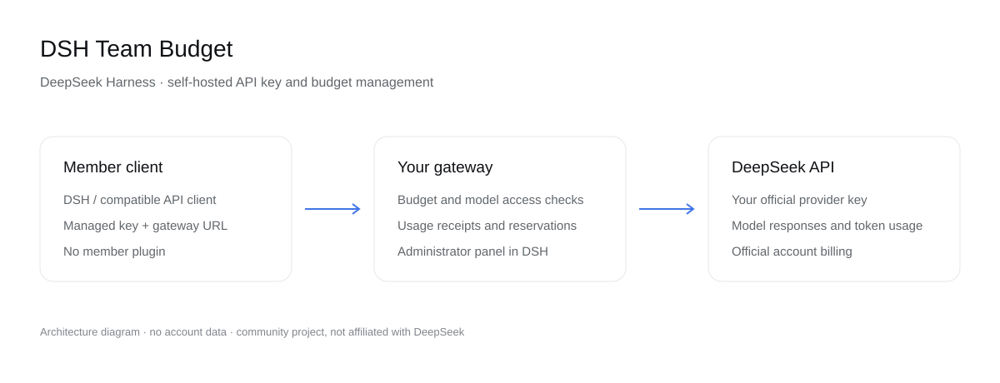

# DSH Team Budget

**Issue DeepSeek member API keys and manage team spending, budgets and model access inside DeepSeek Harness.**

[中文](README.md) · [Setup](docs/SETUP.md) · [Releases](https://github.com/liuguangyu272/dsh-team-budget/releases) · [Issues](https://github.com/liuguangyu272/dsh-team-budget/issues)



One administrator plugin plus a self-hosted gateway. Members configure a generated key and the gateway base URL in DSH or a compatible API client; they do not install a plugin or join the administrator's network.

## Features

- Per-member monthly/daily budgets and shared upstream monthly budgets, using Beijing calendar periods.
- Atomic pre-reservations before provider calls; actual token receipts settle costs afterward.
- Model allowlists, rate/concurrency/output limits, budget alerts, key rotation, disable and deletion.
- Native DSH dashboard: real 7/30-day spending charts, budget utilization, member ranking and search.
- Chat Completions, Responses, Anthropic Messages and standalone Search/Fetch routes.
- Streaming receipt parsing; unverified charges remain reserved until administrator reconciliation.
- Encrypted provider secrets, digest-only member keys and retained historical usage after deletion.
- Chinese/English labels; DSH-native light/dark themes.

## Install

First deploy `gateway/` behind your own HTTPS endpoint. Docker Compose, an environment example and a Caddy example are included. Read the bootstrap administrator token locally from `/data/admin-token.txt`; keep it private.

Install the administrator plugin from a release tarball:

```sh
dsh plugin --profile desktop add ./dsh-team-budget-0.1.0.tgz
```

Or install the versioned Git repository:

```sh
dsh plugin --profile desktop add github:liuguangyu272/dsh-team-budget#v0.1.0
```

Open **API key management**, connect your gateway URL and administrator token, add your own DeepSeek provider key and issue member keys. Members set the generated key and `https://your-gateway.example/v1` in a custom model provider. A member key does **not** authenticate at the official DeepSeek endpoint.

## Scope

Costs are estimates based on provider usage receipts and a maintained tariff table, not official invoice data. Reservations use peak prices; remaining budget may be insufficient to reserve another full call. Published price snapshot: 2026-11-11; holiday calendars: 2026–2027.

Only gateway traffic is metered and controlled. Alerts are in-panel; there are no email or mobile notifications. The gateway requires server availability. In-flight requests complete and settle after a key is deleted. Requests with missing usage receipts require manual reconciliation. Hidden server-side history, built-in model web tools and unknown-price models remain closed.

Node.js 24.9+; no third-party gateway runtime dependencies. Tested against DSH 0.2.1-rc.5, not every future version. The public source includes 29 passing local tests. Docker templates must be validated for your own domain and infrastructure.

```sh
npm test
npm pack --dry-run
```

[Contributing](CONTRIBUTING.md) · [Security](SECURITY.md) · [MIT license](LICENSE)

Community project. Not affiliated with or endorsed by DeepSeek.
