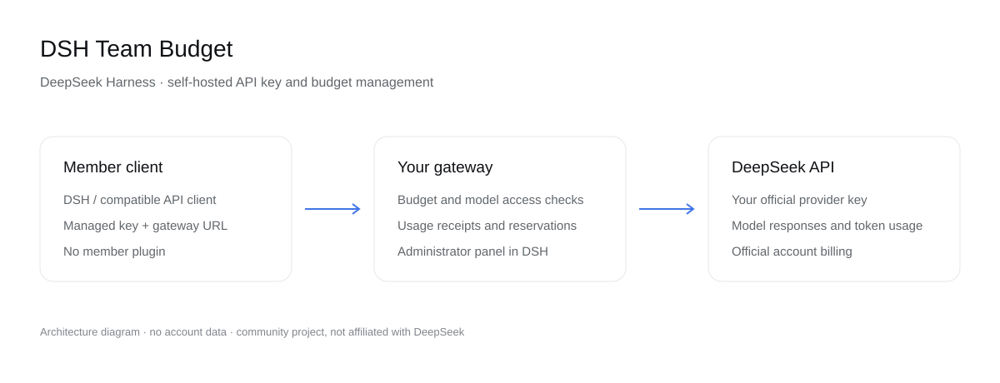

# DSH Team Budget

**给团队分发 DeepSeek 成员密钥，在 DeepSeek Harness 里管理用量、预算和模型权限。**

[English](README.en.md) · [安装与部署](docs/SETUP.md) · [发布版本](https://github.com/liuguangyu272/dsh-team-budget/releases) · [报告问题](https://github.com/liuguangyu272/dsh-team-budget/issues)

  



## 解决什么问题

多人共用 DeepSeek 账户余额时，为每人生成独立密钥，分别设置预算、模型权限并查看用量。管理员在 DSH 中操作；成员只需填写 **成员密钥 + 你的网关地址**，不需要安装本插件，也不限于同一局域网。

```text
成员的 DSH / 兼容客户端
        ↓ 成员密钥 + 网关地址
自托管网关：检查预算与权限，记录用量
        ↓ 管理员保存的官方密钥
DeepSeek 官方 API
```

## 功能

- 独立成员密钥：生成、换钥、停用、删除；删除后原密钥立即失效，历史账目保留。
- 每月 / 每日预算，官方密钥下的团队共用月预算；按北京时间切换周期。
- 请求前原子预留费用，避免并发调用重复使用同一份预算。
- 预算阈值提醒、模型白名单、频率 / 并发 / 输出上限。
- 原生 DSH 面板：近 7 / 30 天费用趋势、预算环形图、成员排行与名称搜索。
- Chat Completions、Responses、Anthropic Messages 和独立 Search / Fetch 接口。
- 普通和流式用量结算；缺少完整用量时保留预留，交由管理员核对。
- 官方密钥加密存储、成员密钥只保存摘要；不持久保存对话正文与工具参数。

## 快速开始

### 1. 部署网关

需要一台可被成员访问的服务器和 HTTPS 地址。仓库已包含 Docker Compose 和 Caddy 配置示例。

```sh
git clone https://github.com/liuguangyu272/dsh-team-budget.git
cd dsh-team-budget
cp .env.example .env
# 编辑 .env，把 GATEWAY_PUBLIC_BASE 改为自己的 HTTPS 地址
docker compose up -d --build
```

网关只向服务器本机开放 `8791` 端口。配置 HTTPS 反向代理后，在服务器本地读取 `data/admin-token.txt` 中的初始管理员令牌：

```sh
docker compose exec gateway cat /data/admin-token.txt
```

这个令牌只用于管理员连接面板，请勿发给成员或贴到 GitHub。

### 2. 管理员安装插件

下载 [Release](https://github.com/liuguangyu272/dsh-team-budget/releases/latest) 的 `dsh-team-budget-0.1.0.tgz`，在 DSH 插件页添加该文件；有 CLI 时也可使用：

```sh
dsh plugin --profile desktop add ./dsh-team-budget-0.1.0.tgz
```

从源码安装：

```sh
dsh plugin --profile desktop add github:liuguangyu272/dsh-team-budget#v0.1.0
```

打开左侧「API 用量管理」，首次填写网关地址和管理员令牌。验证连接成功后，添加自己的官方 API Key，创建成员密钥。

### 3. 成员接入

在 DSH 的自定义模型接口中填写：

| 设置 | 示例 |
|---|---|
| 协议 | OpenAI Chat Completions |
| API Key | 管理员生成的 `sk-team-…` 密钥 |
| Base URL | `https://gateway.example.com/v1` |
| 模型 | 管理员授权的模型，例如 `deepseek-flash` |

成员密钥不能填到默认 DeepSeek 官方地址直接使用；它由你的网关验证。管理员电脑关闭后，服务器仍可接收调用。

## 计费与限制

费用根据官方返回的 Token 和维护的价格表估算，**最终以 DeepSeek 官方账单为准**。调用前按高峰价和输出上限预留，剩余额度不足以预留一次请求时就会提前拒绝。

提醒目前显示在管理面板内，不包含邮件、微信或手机推送。只有通过本服务的请求会被统计和限制；原始官方密钥直接调用官方接口不在管理范围内。安装前的历史用量不会自动补录。服务器离线时成员密钥不能使用。

计价表核对日期：2026-11-11；节假日日历覆盖 2026–2027。价格或模型目录变化时需要维护。当前不开放服务端历史引用、模型内置联网工具与未知计价模型。[部署、维护与支持范围](docs/SETUP.md)。

## 开发与验证

Node.js **24.9+**，网关零第三方运行依赖。当前针对 DSH **0.2.1-rc.5** 验证；未宣称兼容所有未来版本。

```sh
npm test
npm pack --dry-run
```

发布前本地 **29 项测试通过**，覆盖并发预算预留、协议用量、密钥删除、完整历史图表和首次连接凭据。私有开发环境做过真实 DSH 界面与最小 DeepSeek 调用验证；公开仓库不包含开发者部署信息。Docker 部署模板需按自己的域名和服务器验证。

欢迎提交可复现问题、兼容性验证、价格更新和界面改进。觉得有用可以 Star，让更多需要团队预算管理的人找到它。

## 许可证与关系说明

[MIT](LICENSE)。本项目为社区项目，与 DeepSeek 官方无隶属或背书关系。界面遵循 DSH 原生主题变量，不使用官方品牌图标。[安全说明](SECURITY.md)。
